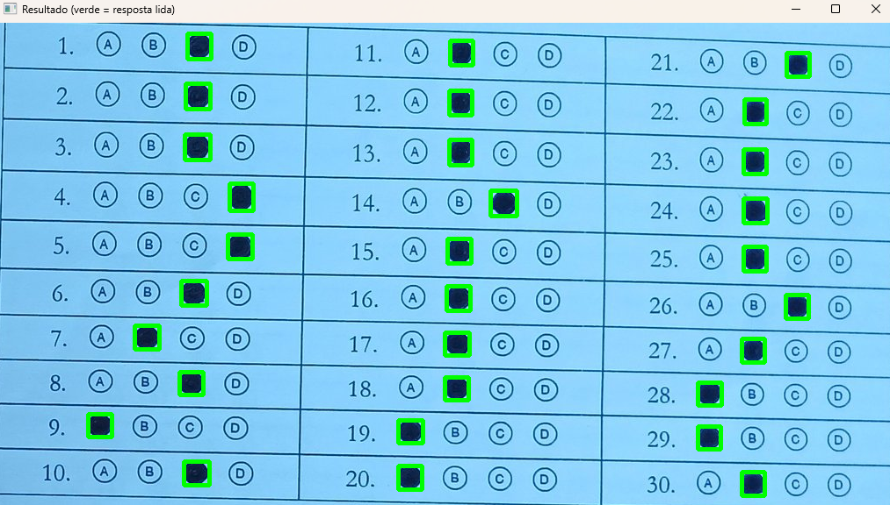

# OMR: Leitor de Gabaritos com OpenCV

Leitor de gabaritos de múltipla escolha (Optical Mark Recognition) feito com OpenCV , sem redes neurais. Recebe a foto de um gabarito de 30 questões e devolve a alternativa marcada em cada uma.



## Resultados

Avaliado em 145 fotos reais de gabaritos (4.350 questões) do dataset público *OMR Image Dataset*:

| Métrica | Valor |
|---|---|
| Acurácia por questão | **99,4%** |
| Imagens em que as 120 bolinhas foram detectadas | **145 de 145** |

As fotos têm iluminação desigual, sombras e leve inclinação, o que torna o problema mais difícil do que ler um gabarito escaneado.

**Duas observações sobre a medição:**

- Os parâmetros foram ajustados olhando este mesmo conjunto de imagens. São poucos (limite de preenchimento, filtros de área/proporção e threshold), mas o número não é uma medida de generalização para outros modelos de gabarito.
- Parte dos "erros" parece vir do próprio dataset. Na inspeção visual da imagem 13, vários casos em que o programa discorda do `OMR_Ans.csv` eram bolinhas claramente preenchidas na folha, enquanto o gabarito oficial apontava uma bolinha vazia. Ou seja, a acurácia real provavelmente é um pouco maior que a medida.

## Como funciona

```
foto -> pré-processamento -> detecção das bolinhas -> organização -> leitura -> respostas
```

1. **Pré-processamento** (`preprocessamento.py`). Tons de cinza, blur gaussiano e **threshold adaptativo**, que compara cada pixel com a média da vizinhança e por isso aguenta sombra e iluminação desigual. Marcas e contornos ficam brancos sobre fundo preto.
2. **Detecção das bolinhas** (`deteccao.py`). `findContours` com filtros de tamanho e formato. Os limites de área são **relativos ao tamanho da imagem**, então funcionam em qualquer resolução. O tamanho típico (mediana) elimina o que destoa, como dígitos e letras.
3. **Recuperação** (também em `deteccao.py`). Se faltar até uma bolinha por coluna (por exemplo, quando a marcação encosta na linha da tabela), ela é recriada pela geometria das outras linhas da mesma coluna.
4. **Organização** (`leitura.py`). As 120 bolinhas saem desordenadas e viram 30 questões: separação em 3 colunas por `x`, ordenação por `y` dentro de cada coluna, grupos de 4 e ordenação por `x` para obter A, B, C, D.
5. **Leitura** (`leitura.py`). Para cada bolinha, uma máscara circular mede a fração de pixels escuros no miolo (`bitwise_and` + `countNonZero`). Acima do limite, a bolinha está marcada. Resultado por questão: letra, `-` (em branco) ou `*` (mais de uma marcada).

## Decisões técnicas e problemas resolvidos

- **`RETR_EXTERNAL` encontrava só 20 das 120 bolinhas.** As linhas da tabela formam caixinhas fechadas, e esse modo ignora formas dentro de outra forma. Trocar por `RETR_CCOMP` (descartando os "buracos" dos anéis pela hierarquia) resolveu.
- **Resultados quase idênticos de 0.4 a 0.6 no limite de preenchimento.** Escolhi 0.5, no meio da faixa estável, em vez do valor que empatou por acaso.
- **Uma bolinha faltando derrubava a imagem inteira.** Em 10 fotos, a marcação encostava na linha da tabela e a bolinha passava a fazer parte do contorno da grade. Agora o código separa as colunas, identifica a linha incompleta e recria a bolinha pela geometria das outras. Recuperar só quando faltava uma no total salvou 9 fotos (92,7% → 98,7%); a décima tinha uma faltando em duas colunas diferentes, e recuperar até uma por coluna resolveu (98,7% → 99,4%).
- **Análise de erros antes de ajustar.** Foi a contagem de erros por tipo que mostrou que o gargalo era a detecção, e não a leitura. Sem isso, eu teria gasto tempo ajustando o limite de preenchimento, que quase não influenciava.

## Estrutura

```
projeto_omr/
├── omr.py                # arquivo principal: ler_gabarito() e linha de comando
├── configuracoes.py      # constantes e parâmetros
├── preprocessamento.py   # abrir a foto e deixar ela binária
├── deteccao.py           # achar as bolinhas (e recriar as que sumiram)
├── leitura.py            # organizar em questões e ler as respostas
├── desenho.py            # desenhar o resultado na foto
├── testar.py             # avalia a acurácia no dataset
├── requirements.txt
├── README.md
├── docs/
│   └── exemplo.png       # imagem usada neste README
└── omr_dataset/          # dataset (não versionado, veja abaixo)
    ├── OMR_Image_Resized/  # 1.jpg ... 145.jpg
    └── OMR_Ans.csv
```

Todos os parâmetros ajustáveis (tamanho do blur, limites de área, limite de preenchimento) ficam em `configuracoes.py`.

## Instalação

```bash
pip install -r requirements.txt
```

As versões em `requirements.txt` são as usadas para medir os resultados acima (com Python 3.14). Outras versões do OpenCV podem mudar um pouco os números.

Baixe o dataset no Kaggle (link na seção [Dataset](#dataset)) e extraia em `omr_dataset/`, mantendo a estrutura acima.

## Uso

**Ler uma foto pela linha de comando:**

```bash
python omr.py omr_dataset/OMR_Image_Resized/1.jpg
```

Imprime as respostas e abre uma janela com a leitura desenhada sobre a foto. Use `--sem-janela` para só imprimir.

**Como biblioteca:**

```python
import omr

imagem = omr.carregar_imagem("foto.jpg")
respostas, questoes = omr.ler_gabarito(imagem)
print(respostas)   # ['C', 'C', 'D', ..., '-', '*']
```

Se a foto não tiver as 120 bolinhas (cortada, desfocada, outro modelo de folha), `ler_gabarito` levanta `omr.GabaritoNaoDetectado`.

**Avaliar no dataset:**

```bash
python testar.py              # relatório de acurácia e tipos de erro
python testar.py --mostrar 5  # abre as 5 piores imagens
```

Nas janelas: verde = acertou, vermelho = leu errado, amarelo = resposta do CSV.

## Limitações

- Layout fixo: 30 questões em 3 colunas de 10, com 4 opções (A-D).
- A organização assume que o gabarito está razoavelmente alinhado. Fotos muito rotacionadas ou com forte perspectiva podem embaralhar as questões.
- Os parâmetros foram calibrados neste dataset e podem precisar de ajuste para outras câmeras ou condições de luz.
- Marcações muito fracas, apagadas ou ambíguas continuam sendo a principal fonte de erro de leitura.

## Próximos passos

- Correção de perspectiva (`getPerspectiveTransform` + `warpPerspective`) para fotos inclinadas.
- Detectar o layout automaticamente, em vez de assumir 30×4.
- Validar com fotos novas, fora do dataset, para medir a generalização.
- Interface simples (web ou desktop) para corrigir provas inteiras.

## Dataset

*OMR (Optical Mark Recognition) Image Dataset*, disponível no Kaggle (autor: Thejas An, licença MIT).

Link: https://www.kaggle.com/datasets/thejasan/omr-optical-mark-recognition-image-dataset
